# SkySpark Lite (working title)

A lightweight, SkySpark-style analytics platform built on [Haxall](https://haxall.io) (the open-source core of SkySpark) and Xeto, styled with the ATS brand (see [the design system](docs/design-system.md)). This is **Phase 1**: a library of Xeto equipment specs, a realistic demo building with planted faults, a **Site Organization** app (navigate and inspect the model, check it against its specs, and add, edit, move and delete sites, equipment and points) and a **Trend Viewer** app (time-series charts).


There are no device connectors yet. The demo building comes from generated data loaded through the same Haystack API a connector would use, and anything you add or change in the app goes through that API too.

## What you need

| | |
|---|---|
| **Docker Desktop** | installed and *running* (check that its icon says it is running) |
| **Node 24** | `node --version` should say v24 or newer |
| **make** | `make --version` (it comes with the macOS developer tools) |
| **A modern browser** | Chrome, Brave, Edge or Safari |
| Disk and time | about 3 GB, and about 3 minutes for the very first build |

Tested on macOS with Apple Silicon. See [known limitations](docs/known-limitations.md) for other platforms.

## Quick start

Open a terminal in this folder and run these one at a time.

```bash
cp .env.example .env
```
Now open `.env` in a text editor and change `HAXALL_SU_PASSWORD` to a password of your own (letters and numbers, no spaces). The username is `su`. This file is private and never committed.

```bash
make install     # downloads the Node packages (about 20 seconds)
make up          # builds Haxall the first time (about 3 minutes), starts it, loads the demo building
make ui          # starts the web app: leave this running, then open http://localhost:5173
```

Sign in with `su` and the password you chose. You land in **Site Organization** on the demo site.

To check that everything is wired up, in a second terminal run `make spike`: it logs in, prints Haxall's version and the site name.

To stop: press Ctrl-C in the `make ui` terminal, then `make down`.

> **Starting again later:** `make up` then `make ui`. `make up` also reloads the demo history if Haxall was restarted (Haxall keeps history in memory only, see [Good to know](#good-to-know)).

## A tour

The demo is "Demo Office", a fictional 50,000 sq ft office in Los Angeles: 2 air handlers, 10 VAV boxes, a main electric meter and 2 submeters (15 pieces of equipment, 124 points), with 90 days of history at 15-minute intervals ending the moment you load it, and **six faults planted on purpose**.

### Sign in


If you type the wrong password the page says so. If Haxall is not running it says that instead ("Haxall is unreachable").

### Site Organization: navigate and inspect


- **Tree** on the left: Site, Equipment, Points. Open an equipment to load its points. A red `!` marks anything that does not fit its spec.
- **Detail** on the right: every tag of the selected record. References (like the site or equipment) are links. Markers are shown as small chips.
- The green **Fits ats::...** badge is Xeto's `validate()` run live: the record has all the tags its spec requires, and an equipment also has every required point.

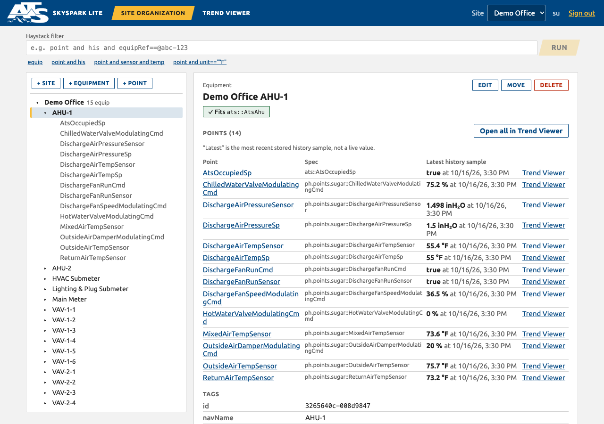

An equipment lists its points with the **latest history sample** and its time (this is the last stored sample, not a live value, because there is no connector), plus an **Open in Trend Viewer** button on each.

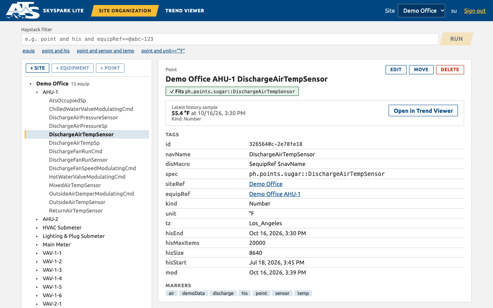

**When something is wrong the badge says what.** This example is an air handler record with none of its required points (it was added just for the screenshot and removed again):


The **filter bar** takes any Haystack filter. Haxall's own message appears if it is not valid.

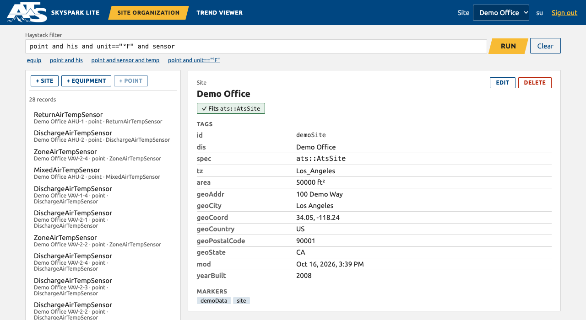

Your view is in the address bar (`?sel=...&filter=...`), so you can bookmark or share a link to any record.

### Site Organization: add, edit, move and delete
Changes are saved to Haxall straight away, and the badges and tree update to match. The buttons above the tree add things *inside whatever is selected*; **Edit**, **Move** and **Delete** are on the selected record.

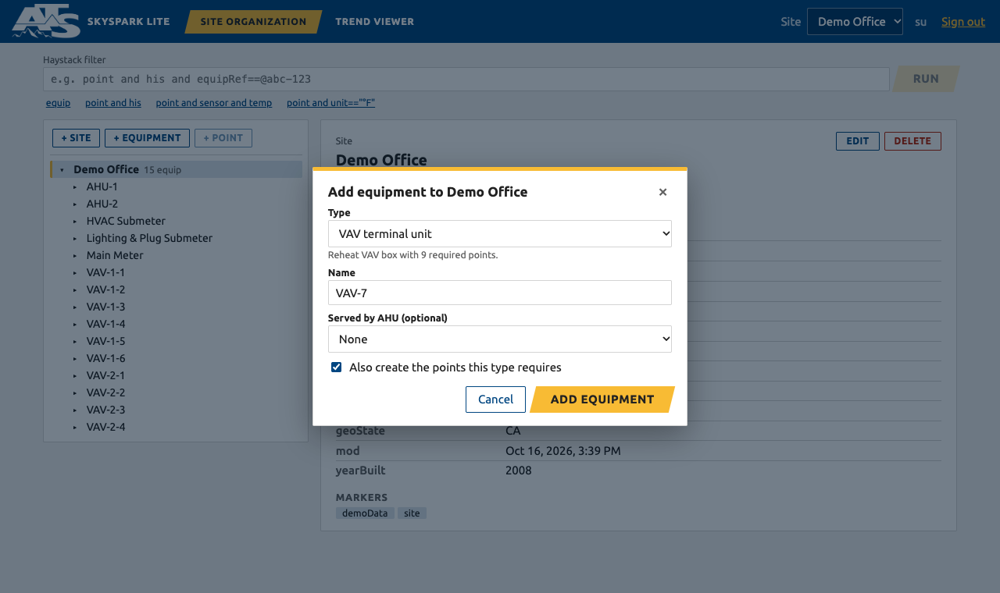

- **+ Site** creates a site from the `ats::AtsSite` spec (name, floor area, time zone and address).
- **+ Equipment** goes into the selected site or equipment. Pick a **template** (AHU, VAV, main meter, submeter) and it also creates every point that type requires, ready to chart; or pick any of the ~80 other standard Haystack equipment types and add its points yourself. A VAV can be linked to the AHU that serves it; a submeter must be linked to its meter.
- **+ Point** goes into the selected equipment. If required points are missing, they are listed first with **Add all** (or one at a time). Otherwise search the ~400 standard point types, or make a custom point. Units are checked against Haxall's own list.

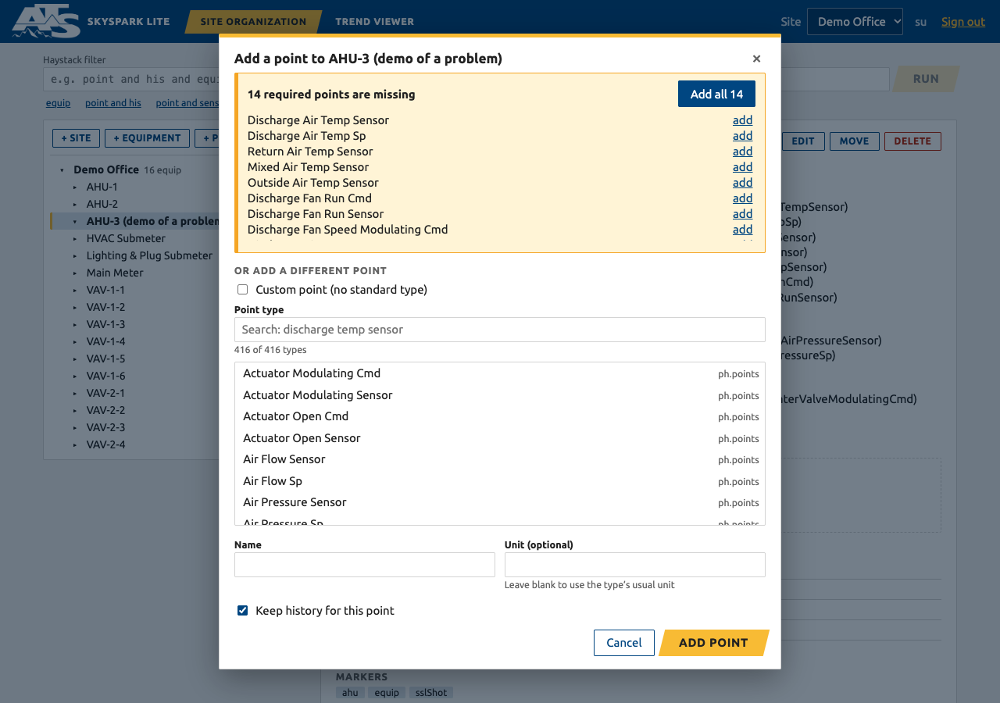

- **Edit** renames a record and lets you change, add and remove its tags (text, numbers with units, true/false, markers, links). Only what you changed is sent. The id, the links to the site and equipment, and values Haxall keeps itself are protected.

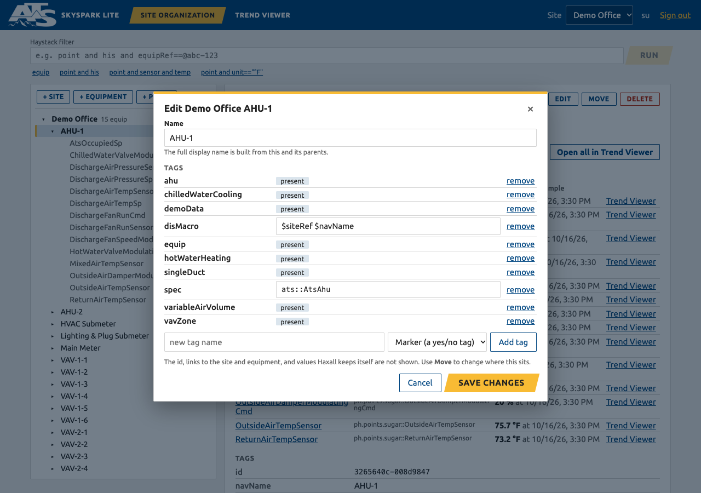

- **Move** puts equipment somewhere else (another equipment, or the top of any site) or a point into another equipment. Everything inside moves too, and moving to another site updates their site (and the points' time zone, if the new site is in a different one). The list never offers a place inside the thing being moved.
- **Delete** shows exactly what goes first (how many pieces of equipment and points, how many stored history samples) and which other records link to it. Those links can be cleaned up at the same time. A site also needs its name typed to confirm.

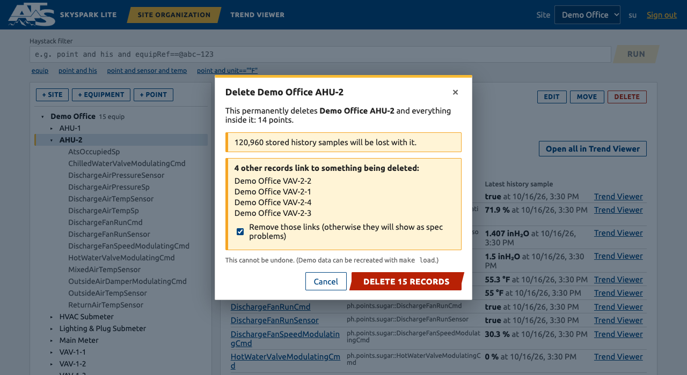

Good to know:
- If someone else changes a record while you have it open, your save is refused with a message instead of overwriting their change.
- Records you add are ordinary Haxall records, tagged the way the specs say. Check them with the spec badge, and chart them in Trend Viewer once history is written to them (there is no connector, so new points start empty).
- `make load` (and a Haxall restart) recreates the **demo** building. Changes to demo records are lost then, and anything you attached to them is left pointing at records that no longer exist. Sites you create yourself are not touched.

### Trend Viewer: charts
Tick up to 10 points in the picker (or press **Open in Trend Viewer** in Site Organization), pick a date range, and read the chart. By default each unit gets its own panel and axis, all sharing one time axis and zoom (the *Overlay* button puts everything on one plot instead). Scroll over the chart, or drag the bar beneath it, to zoom; **Reset zoom** appears when you have. Hover for every point's exact value at that time. **Table** shows the same numbers and **Export CSV** saves them.

Each planted fault is easy to spot. The exact times of the current load are in `tools/demo_data/faults.json`, which every load writes afresh (it is not stored in git).

| # | Fault | Where | What you see |
|---|---|---|---|
| 1 | Heating and cooling valves both open | AHU-1, a Mon-Thu about 8 weeks ago | both valve lines jitter open together for four days |
| 2 | Damper stuck | VAV-1-3, Mon-Fri about 5 weeks ago | damper line frozen at 35% while the airflow setpoint keeps moving |
| 3 | Zone temperature flatline | VAV-2-2, about 6-7 weeks ago | one perfectly flat line for 7 days |
| 4 | AHU runs all weekend | AHU-2, a Sat+Sun about 3 weeks ago | fan on continuously through the weekend |
| 5 | Data gap | Lighting & Plug Submeter, about 4 weeks ago | line breaks and a shaded band: no samples for 24 hours |
| 6 | Outside air sensor out of range | AHU-1, about 2 weeks ago | a plunge to -40 F for 18 hours |

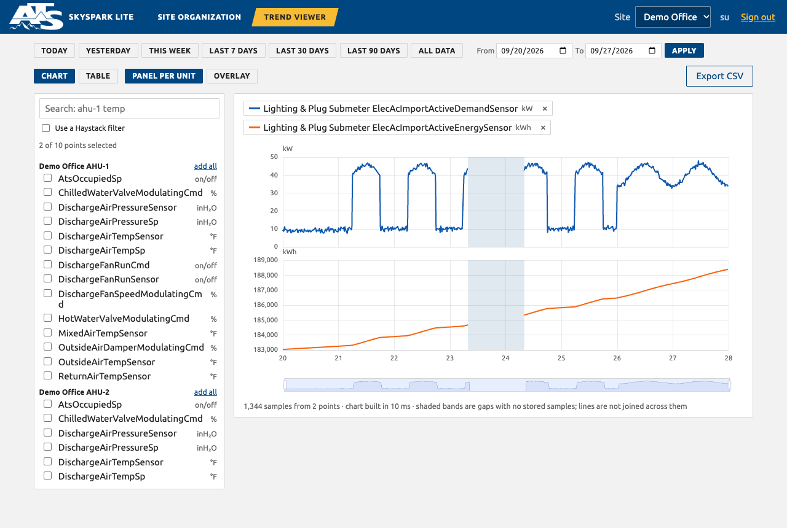

*Fault 5: where samples are missing the line breaks and the gap is shaded. Nothing is drawn across a gap.*

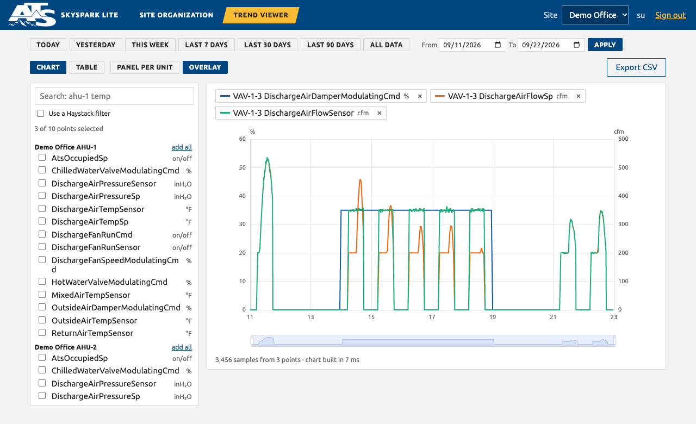

*Fault 2 in Overlay mode (one axis per unit): the blue damper line is frozen while the orange setpoint and green airflow move.*

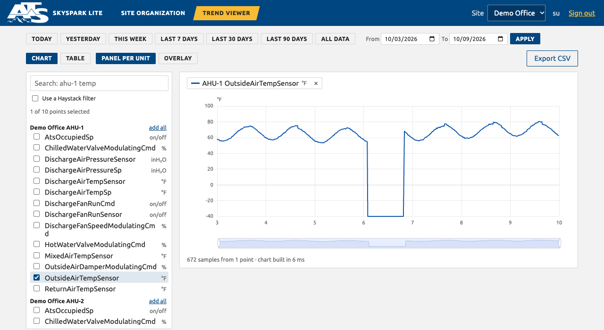

*Fault 6: the -40 F plunge.*

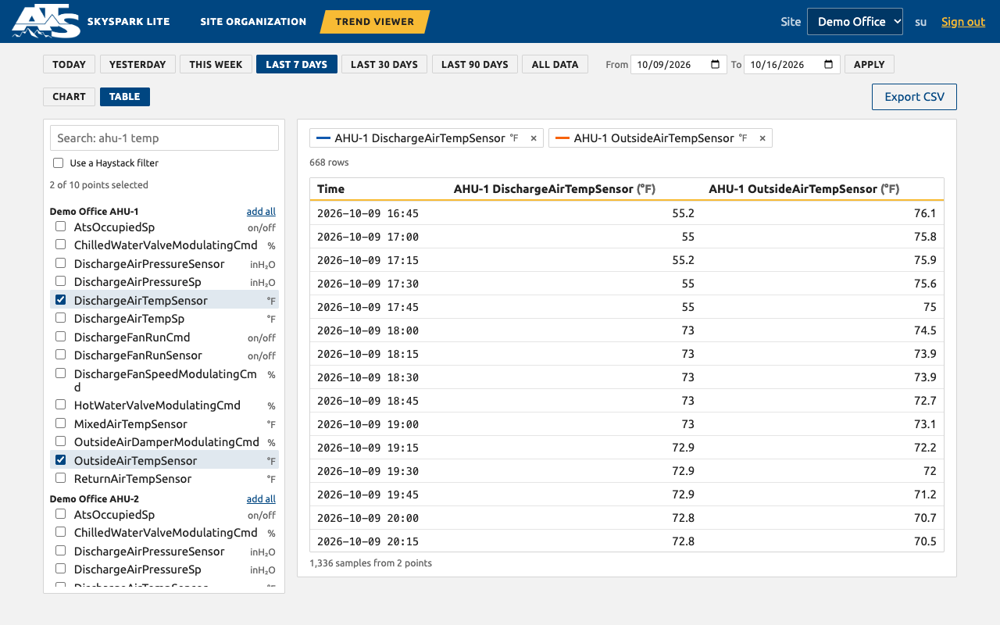

The address bar holds the whole Trend Viewer view too (`?points=...&range=...&view=table&layout=overlay`). Custom ranges look like `range=2026-08-24_2026-08-28`.

## Everyday commands

| Command | What it does |
|---|---|
| `make up` | Start Haxall (builds if needed) and load the demo data if it is missing |
| `make ui` | Start the web app on http://localhost:5173 |
| `make down` | Stop Haxall. Records are kept (history is not, see below) |
| `make logs` | Watch Haxall's log |
| `make status` | Is Haxall running? |
| `make load` | Wipe and reload the demo building and histories (`make load SEED=7` for different data) |
| `make specs` | After editing files in `specs/`: restart Haxall, check the `ats` library compiles, reload demo data |
| `make axon E='libs()'` | Run one Axon expression and print the result |
| `make check` | Lint, type check and unit tests. Needs no Haxall; GitHub runs the same checks on every push |
| `make lint` | Just the linter (oxlint), which looks for likely bugs |
| `make test` | Everything: `make check`, then the live tests against Haxall (Haxall must be running) |
| `make screenshots` | Retake the pictures in this README (needs `make ui` running and Chrome, Brave or Edge). `SHOT_THEME=dark` takes dark ones |
| `make build-ui` | Production build of the web app into `ui/dist` |
| `make reset` | **Deletes the Haxall database**, starts fresh and reloads the demo data |

## Changing the specs

The equipment templates are in [`specs/`](specs/README.md): one small file per kind of equipment, with comments written to be read. [`specs/README.md`](specs/README.md) lists every required point and explains how to add one. After an edit run `make specs`; it tells you exactly which file and line if something does not compile, and `make test` checks the result.

## If something goes wrong

| What you see | What to do |
|---|---|
| `make up` says it cannot connect to Docker | Open Docker Desktop and wait until it says it is running, then try again |
| `make up` says the password is still "change-me" | Open `.env`, set `HAXALL_SU_PASSWORD` to a password of your own, and run `make up` again |
| "port is already allocated" for 8080 | Something else uses port 8080. Change `HAXALL_PORT` in `.env` (for example 8090), then `make down` and `make up` |
| The web app says **Haxall is unreachable** | `make status`; if it is not running, `make up`. The app reconnects by itself |
| The web app returns to the sign-in page | Normal after Haxall restarts: your session ended. Sign in again |
| Sign-in fails with the right-looking password | The password in `.env` only applies when the database is **first created**. Either use the password that was in `.env` at that time, or `make reset` (this erases the database) |
| Site Organization shows no sites, or Trend Viewer charts are empty | `make load` (Haxall keeps history only in memory, so a restart empties it) |
| `make up` fails while building | Check your internet connection (the build downloads Haxall's source) and run `make up` again; see `make logs` for details |
| Everything is broken | `make reset` gives you a fresh database with the demo data |

## Good to know

- **History is kept in memory only** by Haxall: restarting it empties every history, while records (site, equipment, points) are kept. `make up` and `make specs` reload the demo data when histories are missing; if you restart Docker some other way, run `make load`.
- Each point keeps at most `hisMaxItems` samples (the demo sets 20,000; Haxall's own default is only 1000).
- Haxall stores history numbers as 32-bit floats, so values have about 7 significant digits. The screens round to match.
- The browser app talks to Haxall through the dev server (`/api` is forwarded) because Haxall does not allow direct cross-origin requests. The app logs in with a token, never cookies.
- Haxall's own page is at http://localhost:8080 (same `su` login) if you want to use its Axon shell. The API lives at `/api/sys/...`.
- This computer may also run other Docker projects. Everything here is named `skyspark_lite_*` and `make down` / `make reset` touch nothing else.
- The full list is in [docs/known-limitations.md](docs/known-limitations.md).

## What is where

```
PLAN.md                    what we are building and why (the agreed plan)
specs/src/xeto/ats/        the Xeto library: Site, AHU, VAV, electric meter and submeter
tools/demo_data/           demo building generator and loader; faults.json is the ground truth for the faults
tools/validate/            spec checks and live tests
tools/screenshots/         makes the pictures in this README
packages/haystack/         the Haystack client shared by the tools and the web app (login, reads, history)
ui/                        the web app (React, TypeScript, Vite): shell, Site Organization, Trend Viewer
ui/src/theme.css           the design tokens: change colours, font and corners here
ui/src/apps/organization/edit/   the dialogs that add, edit, move and delete (the only UI code that writes)
docker/                    how Haxall is built and run (Dockerfile, compose file)
docs/                      the notes below
```

| Document | What it holds |
|---|---|
| [docs/implementation-plan.md](docs/implementation-plan.md) | the chunked plan and a log of every decision made |
| [docs/research-notes.md](docs/research-notes.md) | what was found out about Haxall and Xeto, with sources and test results |
| [docs/known-limitations.md](docs/known-limitations.md) | what is not built, and behaviour that may surprise you |
| [docs/connector-notes.md](docs/connector-notes.md) | where connectors, current values and rules will plug in (Phase 2) |
| [docs/design-system.md](docs/design-system.md) | the ATS colours, logo and rules, light and dark, chart colours, contrast results, and how to change them |
| [specs/README.md](specs/README.md) | the required points of each spec, and how to add one |
