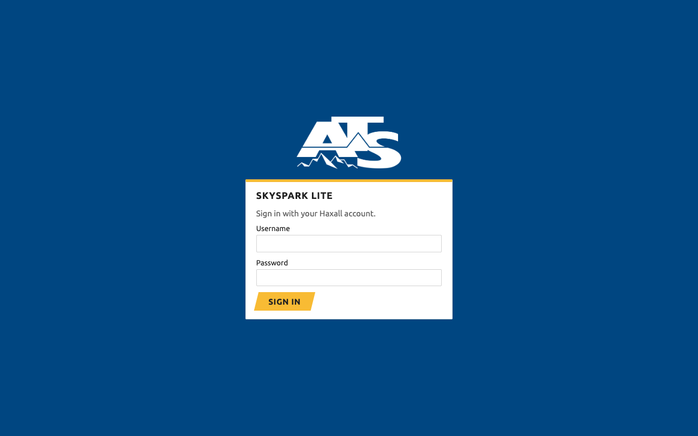
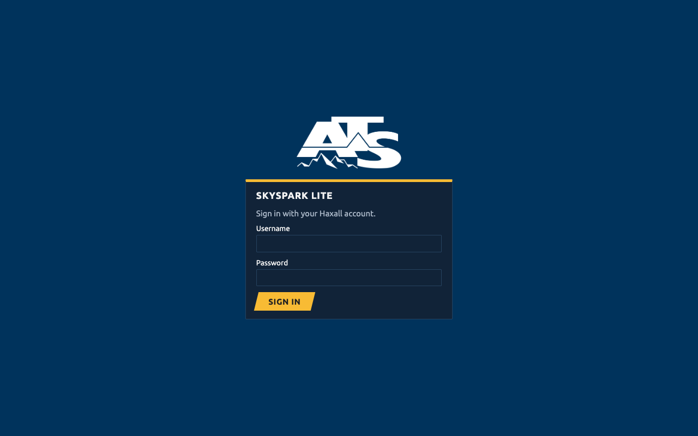
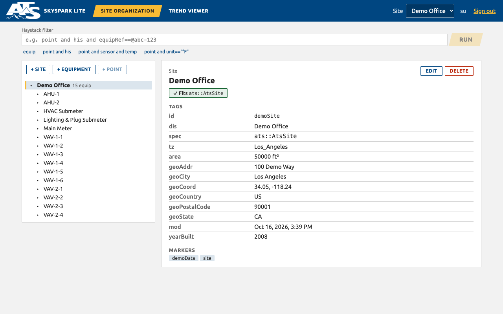
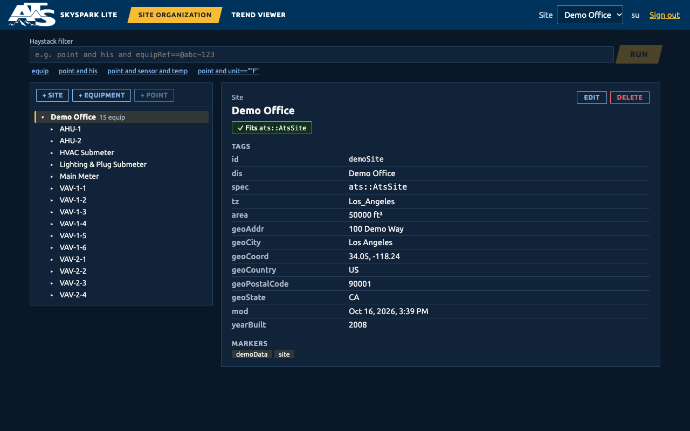
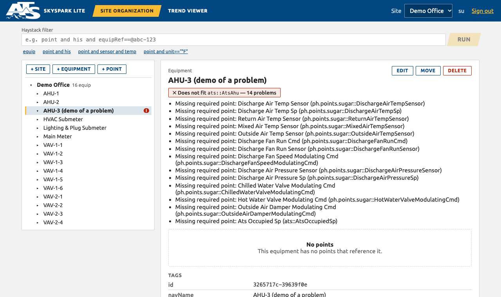
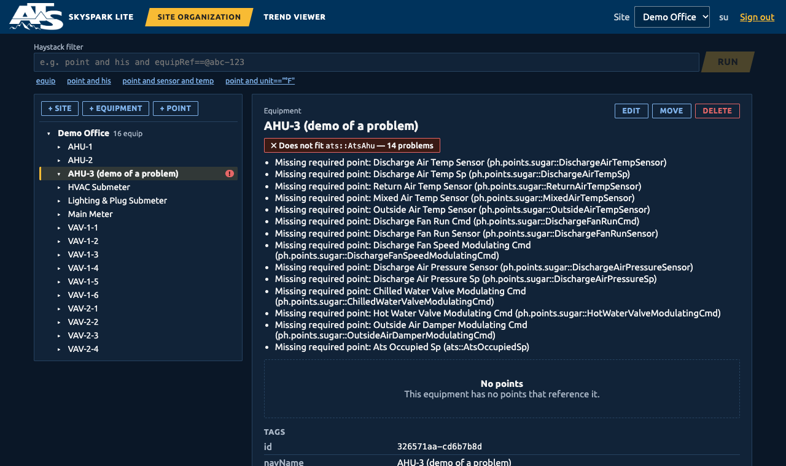
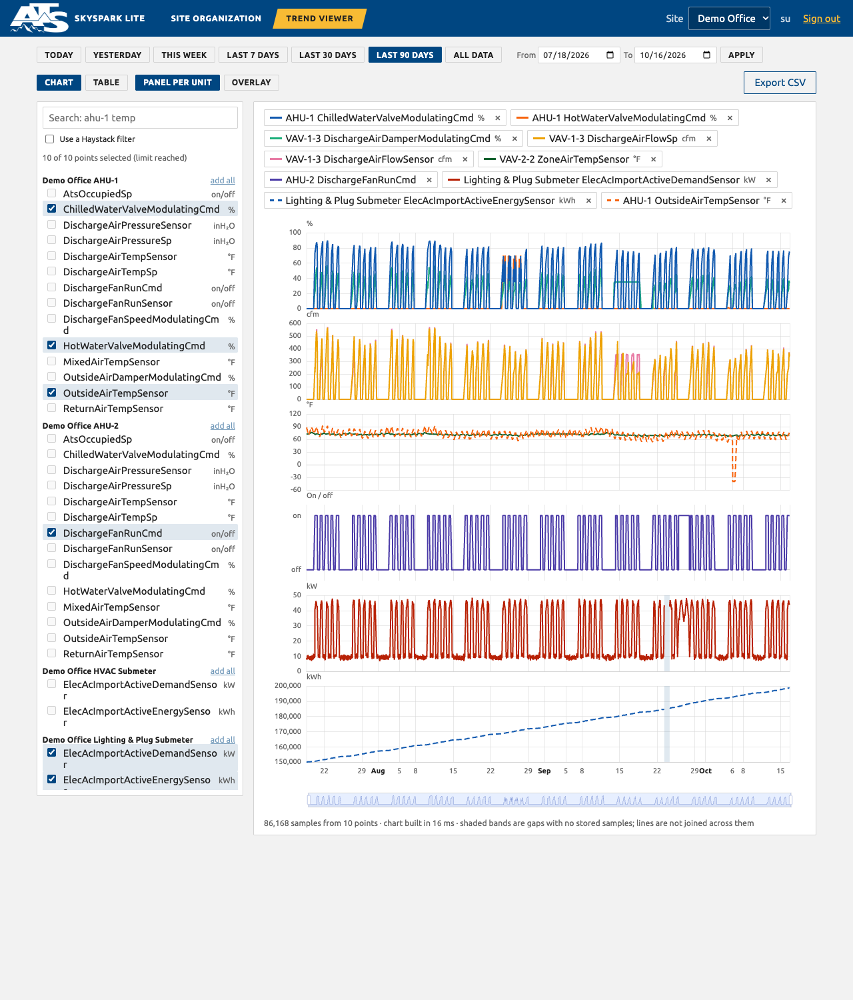

# SkySpark Lite design system (the ATS theme)

The look of the app comes from the ATS website ([atsintegrators.com](https://www.atsintegrators.com/companies/ats-automation/)): its navy and gold, its white logo, square corners, bold uppercase buttons and its Ubuntu typeface. Everything is defined in **one file of variables, [`ui/src/theme.css`](../ui/src/theme.css)**. The components in `ui/src/styles.css` only use those variables, so changing a value in `theme.css` restyles the whole app, in light and dark mode.

| | Light | Dark |
|---|---|---|
| Sign-in |  |  |
| Site Organization |  |  |
| A problem shown |  |  |

## 1. Brand palette

Read from the website's own theme (its palette variables), so these are ATS's colours, not approximations.

| Name | Value | Used for |
|---|---|---|
| Gold | `#f8bb34` | the one main action on a screen, the active tab, the selection marker, focus ring in dark mode |
| Navy | `#004681` | the top bar, links, selected/filled controls in light mode |
| Ink | `#222222` | text |
| Grays | `#636363` `#aaaaaa` `#eaeaea` `#f2f2f2` | secondary text, page background |
| Green | `#13612e` | "fits its spec" |
| Red | `#b82105` | errors, "does not fit" |
| Amber | `#f5a524` | warnings |
| Orange | `#f7630c`, Blue `#1159af` | chart series 2 and 1 |

Made from the navy: deep navy `#00335c` (dark top bar), night `#0a1727` (dark page), night panel `#112338` (dark cards).

## 2. What the colours mean (the tokens components use)

Components never use a brand colour directly; they use a **meaning**. That is what lets light and dark mode differ without touching a component.

| Token | Meaning | Light | Dark |
|---|---|---|---|
| `--bg` | page | `#f2f2f2` | `#0a1727` |
| `--panel` | cards, panes, inputs | white | `#112338` |
| `--text` | body text | `#222222` | `#f2f2f2` |
| `--muted` | secondary text | `#636363` | `#a9b6c6` |
| `--line` | borders, rules | `#d4d4d4` | `#26425f` |
| `--link` | links | navy | `#7fb2ea` |
| `--accent` / `--accent-text` | selected or active control (and its text) | navy / white | gold / ink |
| `--cta` / `--cta-text` | the main action (always gold, slanted) | gold / ink | gold / ink |
| `--chrome` / `--chrome-text` | top bar and sign-in backdrop | navy / white | deep navy / white |
| `--focus` | keyboard focus ring | navy | gold |
| `--ok` `--ok-bg` | success | green, pale green | `#4fae72`, dark green |
| `--warn-line` `--warn-bg` | warning | amber, pale amber | amber, dark amber |
| `--err-line` `--err-bg` | error | red, pale red | `#e66767`, dark red |

Dark mode follows the operating system setting (`prefers-color-scheme`).

## 3. Components and rules

- **One main action per screen** uses the gold, slanted button (every `type="submit"` button: Sign in, Run). This echoes the slanted gold buttons on the ATS site. Everything else is quieter: outlined, or plain text links.
- **Where you are** is gold: the active top-bar tab and the marker beside the selected tree row or result. A **selected** control elsewhere (the chosen date range, Chart/Table, Panel/Overlay) is solid navy in light mode and gold in dark.
- **Status** always carries words as well as colour: the spec badge says "Fits" or "Does not fit" and lists the reasons; the tree shows `!`; messages have a heavy left bar and a heading. Colour is never the only signal.
- **Square-ish corners** (`--radius: 2px`) everywhere, like the ATS site.
- **Uppercase bold small type** for navigation, buttons and range chips; sentence case for everything you read.
- **Type:** Ubuntu (the ATS site's typeface), **bundled with the app** (regular, medium and bold; Latin alphabets) so it looks the same on every machine and works offline. The chart's axis labels use it too. If a character is not in Ubuntu (for example a check mark), the system font supplies it. Monospace for ids, filters and spec names.
- **The logo** (`ui/public/brand/ats-logo-reverse.png`, copied from the ATS website) is white on transparent, so it only appears on navy: the top bar and the sign-in backdrop.
- **Dialogs** (add, edit, move, delete) sit on a dimmed page with a gold top edge, close with Esc or the ×, and keep keyboard focus inside while open. The **destructive main action is red** (the same slanted shape as the gold one); everything else about a dialog is quiet. A change is confirmed with a green notice bar at the top of the page.
- **Focus** is a 3 px ring in navy (light) or gold (dark), gold on the navy top bar. It is never removed.

## 4. Chart colours

Eight series colours in a **fixed order** (never cycled, never generated). A colour stays with its point while others are added or removed. Points 9 and 10 reuse colours 1 and 2 as dashed lines. Text beside a colour is always in normal ink; only the small line key carries the colour.

| # | Light | Dark | Hue |
|---|---|---|---|
| 1 | `#1159af` | `#4a8fe0` | ATS blue |
| 2 | `#f7630c` | `#e8661a` | ATS orange |
| 3 | `#1baf7a` | `#199e70` | aqua |
| 4 | `#eda100` | `#c98500` | amber |
| 5 | `#e87ba4` | `#d55181` | magenta |
| 6 | `#13612e` | `#008300` | ATS green |
| 7 | `#4a3aa7` | `#9085e9` | violet |
| 8 | `#b82105` | `#e66767` | ATS red |

Slots 1, 2, 6 and 8 now use ATS brand hues; the rest are unchanged from the earlier validated palette. The exact set was re-checked with the data-viz palette validator against each real chart surface (white, and `#112338`):

| Check | Light | Dark |
|---|---|---|
| Lightness band | pass | pass |
| Chroma (not grey) | pass | pass |
| Colour-blind separation (worst neighbours) | pass, ΔE 9.1 | pass, ΔE 8.4 |
| Normal-vision separation (worst neighbours) | pass, ΔE 19.6 | pass, ΔE 19.3 |
| Contrast against the chart surface | warning: aqua, amber and magenta are under 3:1 | pass, all 3:1 or better |

The light-mode warning is the expected one for this palette. Its required relief is in place: every series is named in the legend above the chart, in the tooltip, and in the table view, so colour is never the only way to tell lines apart.

The brand **navy and gold are deliberately not chart colours**: navy is too dark to read as a thin line on white, and gold is too light. They stay as interface colours.

## 5. Contrast

Every text and background pairing the tokens create, measured (WCAG 2.x; 4.5 is AA for normal text, 7 is AAA):

| Pair | Light | Dark |
|---|---|---|
| Body text on panel | 15.9 | 14.2 |
| Body text on page | 14.2 | 16.1 |
| Secondary text on panel | 6.0 | 7.7 |
| Secondary text on page | 5.4 | 8.8 |
| Links on panel | 9.6 | 7.2 |
| Top bar text | 9.6 (white on navy) | 12.9 |
| Top bar secondary text | 6.5 | 8.4 |
| Gold link on top bar | 5.5 | 7.5 |
| Button text on gold | 9.2 | 9.2 |
| Text in OK / error / warning boxes | 13.5 to 14.5 | 11.6 to 14.0 |
| Symbol on the red error dot | 6.5 | 6.0 |
| Focus ring on panel | 9.6 | 9.2 |

The lowest value anywhere is 5.4:1.

## 6. How to change things

| I want to... | Do this |
|---|---|
| change a brand colour | edit it in `theme.css` section 1 and, if a meaning token points at a different value, in section 2 |
| make dark mode warmer or cooler | the dark block of `theme.css` (the meaning tokens) |
| swap the logo | replace `ui/public/brand/ats-logo-reverse.png` (keep it white on transparent, about 2:1) |
| use a different font | change `--font` in `theme.css`, and replace the three `@fontsource/ubuntu` imports at the top of `ui/src/main.tsx` (Fontsource has most Google fonts as packages: `npm install -w @ssl/ui @fontsource/<name>`) |
| change chart colours | edit `--series-1` to `--series-8` (light and dark blocks) **and re-run the palette validator** on the new set; the exact commands and results are in `docs/research-notes.md` |
| retake the screenshots | `make screenshots` (light) and `SHOT_THEME=dark SHOT_ONLY=01,02,05,10 make screenshots` (the dark ones) |

## 7. Notes

- The logo and colours belong to ATS and were taken from its website with permission from the project owner.
- The font comes from the `@fontsource/ubuntu` package (version 5.3.0), under the Ubuntu Font Licence, which allows bundling and redistribution. Keep that licence with the app if it is ever distributed.
- The website's own sizing is larger (18 px body text). The app uses 15 px because it shows dense data.
- Hover and the "slanted" shapes are decoration only; nothing depends on them.
